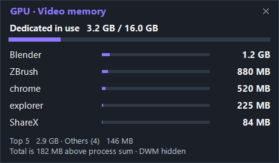
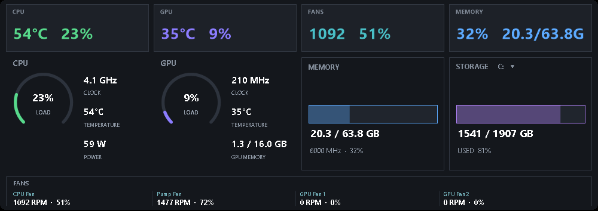
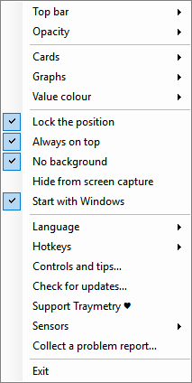
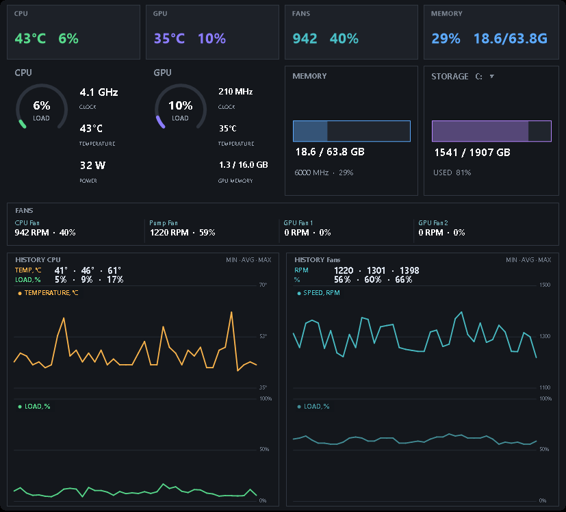

# Traymetry

**A resizable performance overlay for Windows.** Keep FPS, CPU and GPU
temperatures, memory and network speed visible over your work or on a second
monitor. Use a small transparent strip or expand it to see gauges and history.

[**Download Traymetry.exe**](https://github.com/Alsoilia/Traymetry/releases/latest/download/Traymetry.exe)
· [Latest stable release and ZIP](https://github.com/Alsoilia/Traymetry/releases/latest)
· [Русская версия](README.ru.md)


Portable, free and open source under the [MIT license](LICENSE). Requires
64-bit Windows 10 or 11.

## Details in v0.10.0

Click a CPU, GPU, FPS or Network card in either view to see more. Double-click
to switch between compact and expanded views. Dismiss the details with
Escape, a right-click or a click outside the panel.

- **CPU** shows overall use and the five processes using the most CPU.
- **GPU** shows total dedicated video memory in use, the five processes using
  the most and a subtotal for the remaining measured processes. Windows can
  count shared allocations more than once, so the totals can differ.
- **FPS** shows the current source, frame-time history and the 1% low when
  enough data is available.
- **Network** shows adapter speeds and the busiest processes with download
  and upload rates. If per-process rates are unavailable, it shows labelled
  TCP connection counts.



This update also stabilizes the size of changing numbers, applies the
widget's opacity to the compact details panel and adds a Traymetry app icon.
[See the full changelog](CHANGELOG.md).

## What it shows

- **FPS** and frame time, prioritizing the foreground application when it is
  actively presenting frames.
- **CPU** — temperature, load, clock and power, where the sensors allow it.
- **GPU** — temperature, load, clock, power and video memory in use.
- **Memory** — how much is taken and at what clock the modules run.
- **Disks** — space used, with a choice of which drive to watch.
- **Network** — current download and upload rate.

CPU and GPU readings come from the open-source LibreHardwareMonitor; memory,
disks and network traffic also come from standard Windows APIs. FPS comes
from the bundled PresentMon console.



## The point of it

A monitor you keep on screen has to earn the space it takes. Traymetry scales
from a single number to a full panel, and everything about it — size, position,
opacity, which readings appear, whether it has a background at all — is meant to
be changed in a second and then forgotten.



- Drag the edges or corners to resize. Cards rearrange themselves by priority:
  CPU → GPU → memory → network.
- **Pinned** takes the widget out of the way of the mouse entirely: clicks pass
  straight through to the game underneath, while a right or middle click over it
  still reaches the widget.
- The `%` button opens an opacity slider; the background button drops the
  backing plate; the bottom strip expands to the full panel and returns to the
  exact size and position it had before.
- The triangle hides it in the notification area.
- It does not appear in `Alt+Tab`, cannot be lost past the edge of a monitor,
  and moves freely between screens.

Size, position, opacity, the no-background mode, the pin and the state of the
top bar all survive a restart.

Expanded the whole way, it keeps a history of what it has been reading:



## Running it

A finished build is one file, `Traymetry.exe` — the sensor library and its
dependencies are inside it. It needs 64-bit Windows 10 or 11 on an Intel or AMD
processor, with .NET Framework 4.7.2 or newer.

Traymetry offers to set up a local sensor service on first run. Confirm the
Windows administrator prompt to enable it. If PawnIO is needed, setup downloads
the official signed PawnIO 2.2.0 installer and checks its SHA-256 and publisher
certificate before running it. CPU temperatures and power may be unavailable
without the driver. Normal launches of the widget run with standard user
rights.

If a reading is missing after setup, use **Check and repair sensors…** in the
right-click menu. See the [quick-start guide](README-FIRST.txt) for error
reporting and service removal.

## Privacy

Traymetry sends no hardware readings, no process list and no telemetry of any
kind. It reaches the network for exactly two things: checking Traymetry's own
releases, and — with explicit consent — downloading the official PawnIO
installer. The source for both is in this repository.

## Updates

Traymetry never installs an update without permission. At most once a day it
checks GitHub Releases in the background; a manual check sits in the context
menu. Before an EXE is replaced its SHA-256 is compared against the one in a
release manifest signed with the project's key, the current file is kept as a
backup, and the replacement is atomic.

## Support Traymetry

Traymetry is free and stays free. If it turned out useful,
[a donation](https://boosty.to/traymetry/donate) goes toward interface work,
sensor integration, testing across configurations, bug fixes and releases.

## Building from source

Reproducible single-file build, using the compiler that ships with
.NET Framework:

```powershell
powershell -NoProfile -ExecutionPolicy Bypass -File .\build.ps1
```

`build.cmd` is the short form. Every embedded library is pinned by SHA-256 in
`build.ps1`. GitHub Actions builds and tests the application, including a clean
installation of the sensor service on a fresh Windows runner.

## Documentation

- [`docs/ARCHITECTURE.md`](docs/ARCHITECTURE.md) — architectural boundaries and
  the rules for replacing an external engine.
- [`docs/RELEASING.md`](docs/RELEASING.md) — how a release is built, signed and
  verified.
- [`CHANGELOG.md`](CHANGELOG.md) — what changed, and why.
- [`THIRD-PARTY-NOTICES.md`](THIRD-PARTY-NOTICES.md) — LibreHardwareMonitor and
  its dependencies.

## License

MIT.
