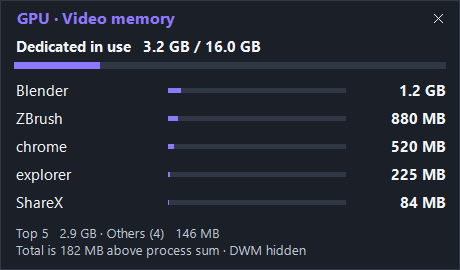
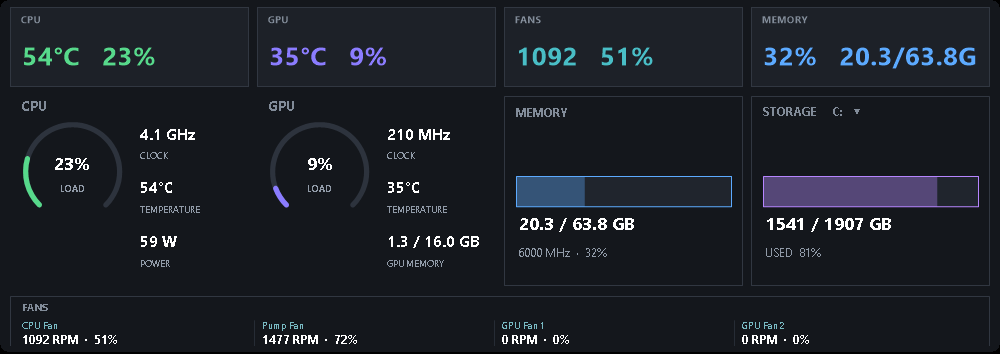
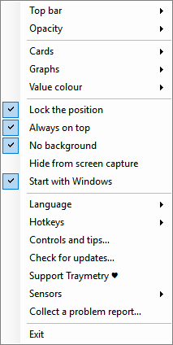
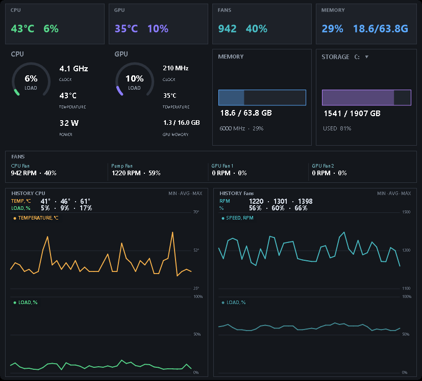

# Traymetry

**Traymetry — виджет производительности поверх окон Windows.** Показывает FPS,
температуры CPU и GPU, память и скорость сети. Можно оставить узкую прозрачную
полоску или раскрыть панель с показателями и графиками истории.

[**Скачать Traymetry.exe**](https://github.com/Alsoilia/Traymetry/releases/latest/download/Traymetry.exe)
· [Последний стабильный релиз и ZIP](https://github.com/Alsoilia/Traymetry/releases/latest)
· [English](README.md)


Бесплатная портативная программа с открытым кодом под [лицензией MIT](LICENSE).
Для 64-битной Windows 10 или 11.

## Подробные панели в v0.10.0

В компактном и развёрнутом виде щёлкните по карточке CPU, GPU, FPS или сети,
чтобы открыть подробности. Двойной клик переключает размер виджета. Панель
закрывается по Escape, правому клику или клику вне неё.

- **CPU** показывает общую загрузку и пять самых активных процессов.
- **GPU** показывает, сколько видеопамяти занято, пять процессов с наибольшим
  расходом и суммарный расход остальных измеренных процессов. Windows
  может учесть общую память несколько раз, поэтому суммы могут расходиться.
- **FPS** показывает источник кадров, график времени кадра и 1% low, когда
  данных достаточно.
- **Сеть** показывает скорость адаптеров, приём и отдачу самых активных
  процессов. Если скорость по процессам недоступна, панель показывает
  количество TCP-соединений с соответствующей подписью.



Размер цифр сохраняется при смене показаний. В компактном виде подробная
панель использует прозрачность виджета. У приложения появилась своя иконка.
[Полный список изменений](CHANGELOG.md).

## Что показывает

- FPS и время кадра. Приоритет у приложения на переднем плане, если оно
  активно выводит кадры.
- CPU: температура, загрузка, частота и мощность, когда датчики доступны.
- GPU: температура, загрузка, частота, мощность и занятая видеопамять.
- Сеть: текущая скорость загрузки и отдачи.
- Оперативная память: занятый объём и частота модулей.
- Накопители: занятое место с выбором отображаемого диска.

Показания CPU и GPU читает LibreHardwareMonitor, FPS — встроенный PresentMon.
Данные памяти, дисков и сети также поступают через стандартные API Windows.



## Управление



- Тяните за края или уголки, чтобы менять размер. Карточки перестраиваются с
  приоритетом CPU → GPU → память → сеть.
- Кнопка прокрутки меняет текущий показатель или порядок карточек.
- Значок `%` открывает отдельный ползунок прозрачности поверх окна.
- Кнопка фона включает режим отображения без задней подложки.
- Пин фиксирует окно и пропускает левый клик к приложению под виджетом.
- Нижняя полоска раскрывает максимальную статистику и возвращает точный
  предыдущий размер и положение.
- Треугольник скрывает окно в область уведомлений.
- Правый клик открывает меню, в котором можно выйти из приложения.

Окно не показывается в `Alt+Tab`, не может потеряться за внешней границей
монитора и свободно переносится между несколькими экранами.

Размер, положение, прозрачность, режим без фона, закрепление и состояние верхней
панели сохраняются между перезапусками. Это относится и к автоматическому
скрытию панели при уменьшении окна.

Развёрнутый до конца, виджет хранит историю того, что читает:



## Обновления

Traymetry не устанавливает обновления без разрешения. Не чаще одного раза в
сутки приложение в фоне проверяет GitHub Releases; ручная проверка доступна в
контекстном меню. Перед заменой EXE сверяется SHA-256 из манифеста, подписанного
ключом проекта. Текущий файл сохраняется как резервная копия. Для обновления
службы датчиков Windows может показать запрос прав администратора.

## Конфиденциальность

Traymetry не отправляет показания оборудования, список процессов или другую
телеметрию. Сетевые обращения выполняются только для проверки релизов Traymetry
и, при явном согласии на первичную настройку датчиков, загрузки официального
PawnIO. Исходный код этих операций открыт в репозитории.

<a id="support-traymetry"></a>

## Поддержать Traymetry

Traymetry остаётся бесплатной и открытой. Если программа пригодилась,
[пожертвование](https://boosty.to/traymetry/donate) идёт на разработку
интерфейса, интеграцию датчиков, тестирование разных конфигураций, исправление
ошибок и выпуск обновлений.

## Запуск

Готовая сборка состоит из одного файла `Traymetry.exe`: библиотека датчиков и
её зависимости встроены внутрь. Поддерживается
64-битная Windows 10/11 на процессоре Intel или AMD с .NET Framework 4.7.2 или новее.

Для низкоуровневых датчиков CPU LibreHardwareMonitor 0.9.6 использует драйвер
PawnIO. Без него температура и мощность CPU могут быть недоступны независимо от
прав запуска. При первом запуске Traymetry объясняет назначение драйвера и после
явного согласия загружает официальный подписанный установщик из GitHub Release
PawnIO 2.2.0 и запускает его через UAC. Перед запуском проверяются закреплённый
SHA-256 и сертификат издателя. Для первичной настройки нужен интернет; сам
установщик не входит в публичную сборку Traymetry. Последующие запуски не
требуют прав администратора. При отказе остальные доступные показатели продолжают
работать.

Служба датчиков устанавливается в `C:\Program Files\Traymetry` после
подтверждения запроса Windows. Если показания пропали, выберите **«Проверить и
починить датчики…»** в контекстном меню и подтвердите UAC. Сбор отчёта об
ошибке и удаление службы описаны в [краткой инструкции](README-FIRST.ru.txt).

## Сборка из исходников

Для воспроизводимой однофайловой сборки используйте 64-битную Windows и
встроенный компилятор .NET Framework:

```powershell
powershell -NoProfile -ExecutionPolicy Bypass -File .\build.ps1
```

Короткий вариант — `build.cmd`. Проверенный переносимый архив создаётся командой:

```powershell
powershell -NoProfile -ExecutionPolicy Bypass -File .\package-preview.ps1 `
  -PackageName Traymetry-win-x64
```

Все встраиваемые библиотеки закреплены по SHA-256 в `build.ps1`. GitHub Actions
собирает и тестирует программу, в том числе проверяет чистую установку службы
датчиков на отдельной машине Windows.

## Лицензия

Исходный код Traymetry распространяется по лицензии MIT. Сведения о
LibreHardwareMonitor и его зависимостях находятся в
[`THIRD-PARTY-NOTICES.md`](THIRD-PARTY-NOTICES.md).

Архитектурные границы и правила замены внешних движков описаны в
[`docs/ARCHITECTURE.md`](docs/ARCHITECTURE.md).

Процесс безопасного выпуска, настройка ключа обновлений и проверка артефактов
описаны в [`docs/RELEASING.md`](docs/RELEASING.md).
